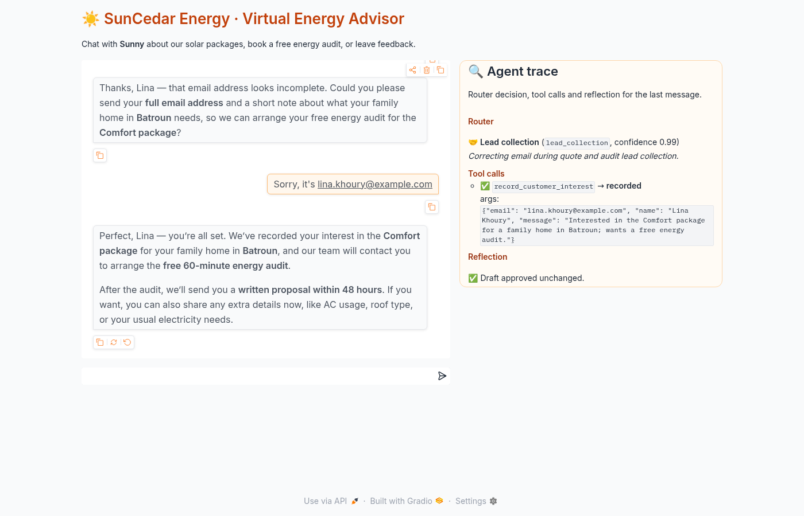
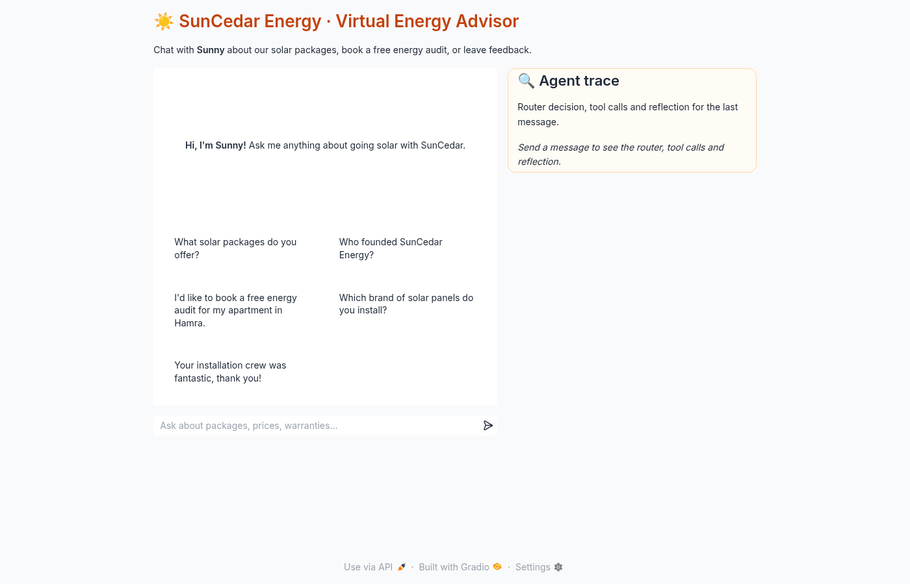
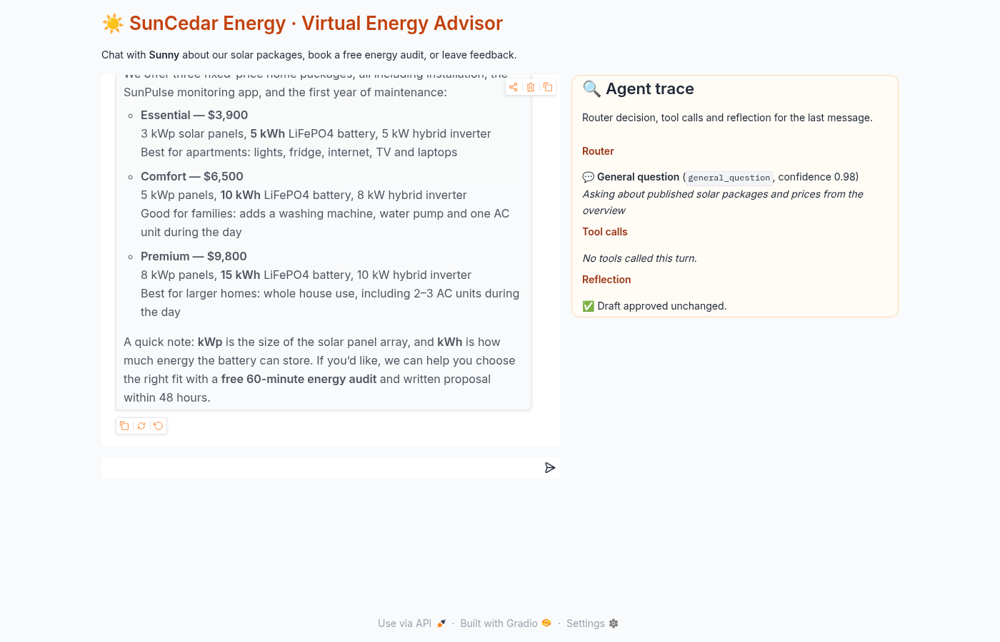
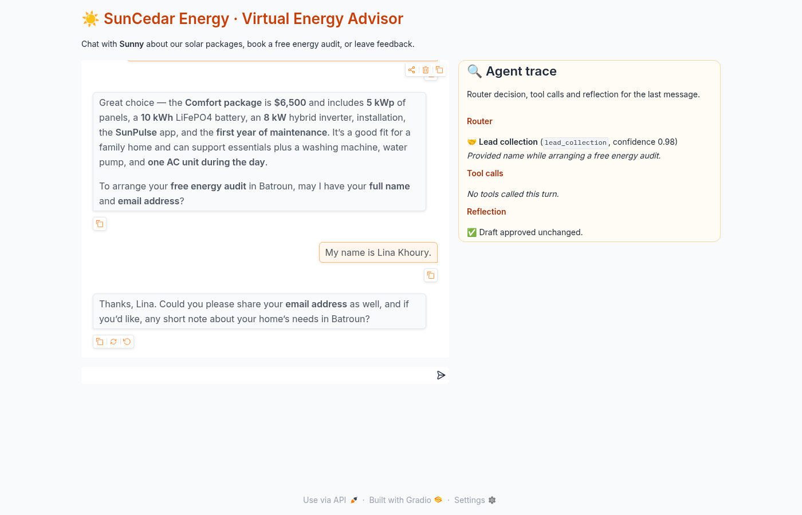
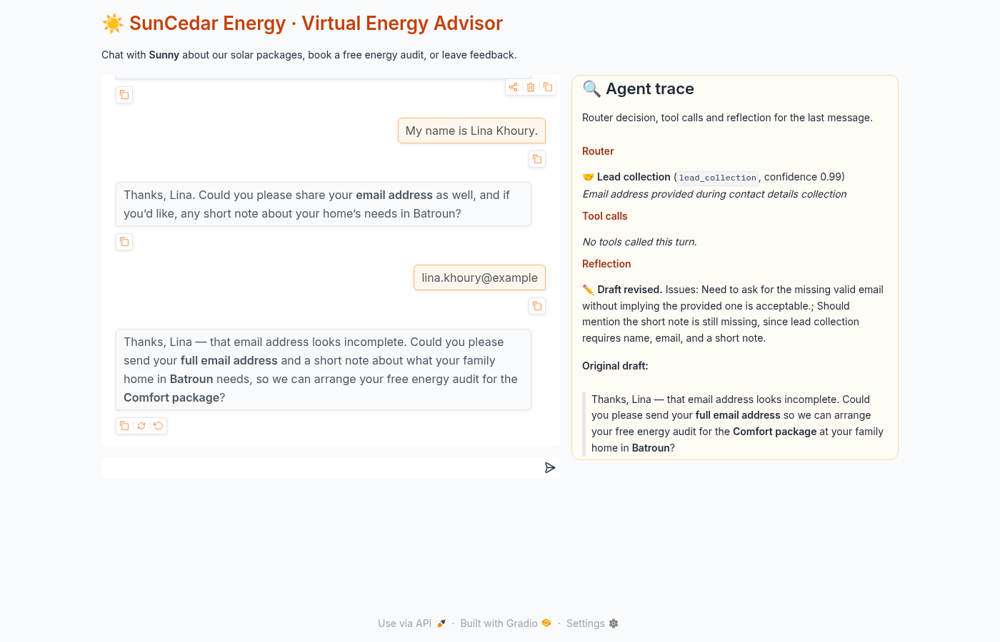
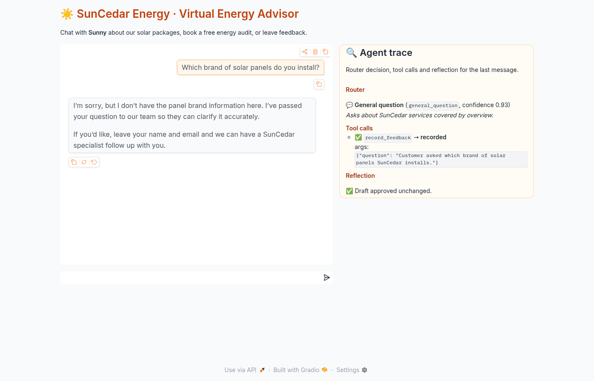
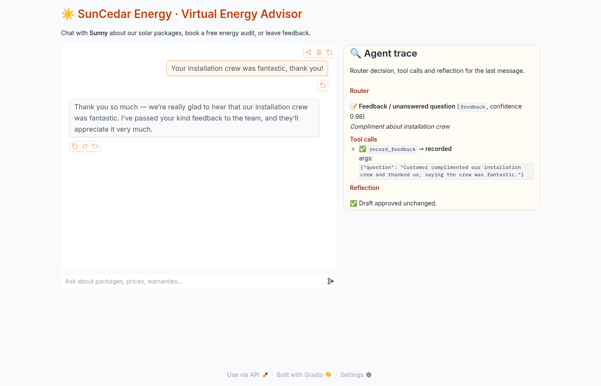
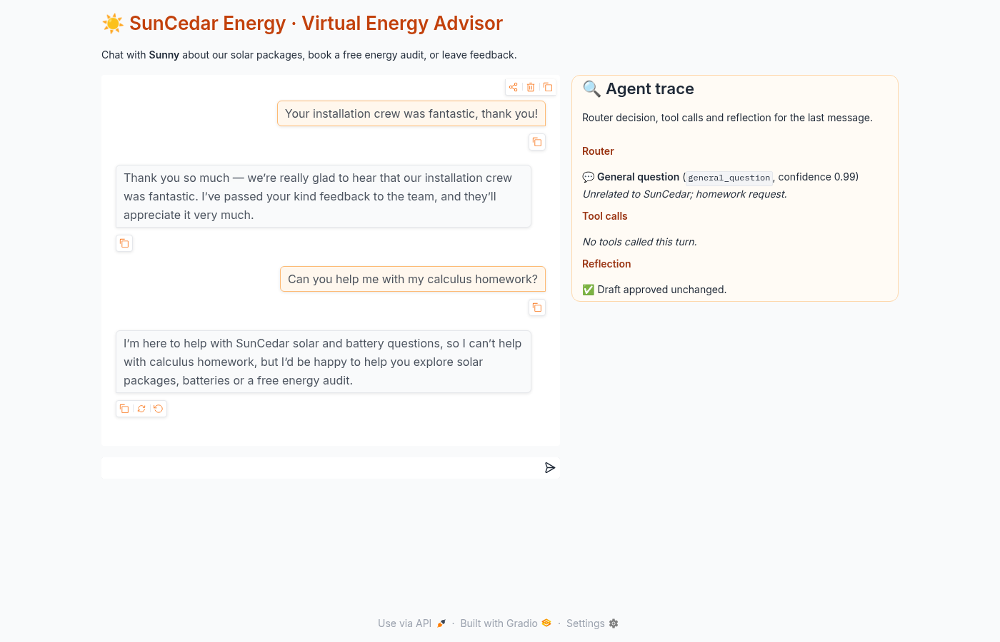
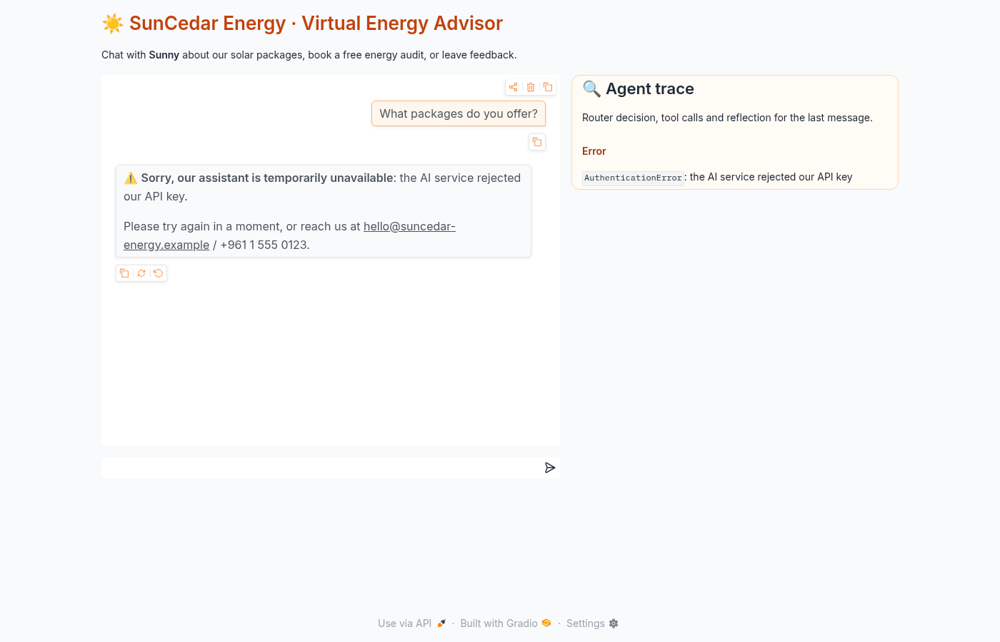

# ☀️ SunCedar Energy — Agent-Powered Business Assistant

**EECE 503P/798S Agentic Systems · C3 Introduction to Agents**

*Sunny* is a chat agent for **SunCedar Energy**, a fictional solar-and-battery installer in Beirut.
It answers questions using the company's business documents and routes every message to one of
three handling paths. It collects sales leads and logs feedback and unanswered questions through
real OpenAI tool calls. Before each reply it checks its own draft (reflection), and it runs as a
Gradio chat app.



## Features

| Assignment requirement | Implementation | File |
|---|---|---|
| Business identity (name, mission, services, team, value proposition) | SunCedar Energy profile | [me/about_business.pdf](me/about_business.pdf), [me/business_summary.txt](me/business_summary.txt) |
| Persona and instructions, clearly separated | `PERSONA` (who Sunny is: tone, style) and `INSTRUCTIONS` (12 numbered rules) | [app.py](app.py) · notebook §3–§4 |
| Router (general / lead / feedback) | LLM classifier in JSON mode that sees the recent conversation; `ROUTES` maps each intent to its own guidance and allowed tools | `route_message`, `ROUTES` · notebook §6 |
| `record_customer_interest(email, name, message)` | Validates the name and email, removes duplicates, appends to `data/leads.jsonl`, sends a push or print notification | notebook §5 |
| `record_feedback(question)` | Appends to `data/feedback.jsonl` and sends a push or print notification | notebook §5 |
| MCP-style tool schemas | `TOOL_DEFINITIONS` (name, description, inputSchema, outputSchema) | notebook §5 |
| System prompt | `system_prompt` = persona + instructions + summary + PDF text (+ the handling guidance for the current route) | notebook §7 |
| Agent interaction | OpenAI Chat Completions with chat history (short-term memory) and tools. Runs the model's `tool_calls`, sends back the results, and loops until the model answers in text | `respond` · notebook §9 |
| Gradio ChatInterface | Multi-turn chat with example prompts, plus an **Agent trace** panel showing the route, tool calls and reflection | `build_demo` · notebook §11 |
| **Bonus:** reflection | A second LLM pass checks the draft against the instructions and revises it if needed. The draft and the revision are logged and shown in the UI | `reflect` · notebook §8 |

## Architecture

```
user message + chat history (last 20 messages)
        │
        ▼
 ROUTER  (gpt-5.4-mini, JSON mode)  ──►  general_question │ lead_collection │ feedback
        │   route → extra guidance + allowed tools
        ▼
 AGENT   (gpt-5.4, Chat Completions + tools)
        │   persona + instructions + business knowledge in the system prompt
        │   tool_calls ──► record_customer_interest ──► data/leads.jsonl   (+ push/print)
        │              ──► record_feedback          ──► data/feedback.jsonl (+ push/print)
        │   tool results fed back to the model until it answers in text
        ▼
 REFLECTION (gpt-5.4-mini) ── approved │ revised   (draft and revision logged)
        ▼
 final reply  +  trace panel in Gradio
```

* **Persona vs. instructions.** The persona only sets identity and tone. The instructions hold the
  rules: knowledge boundaries, when to use each tool, the lead flow, off-topic handling and
  staying in character.
* **Router with context.** The router sees the last 6 messages, so a bare `omar@example.com`
  sent after the bot asked for an email is routed to `lead_collection`. Each route gives the
  agent different guidance and a different set of tools. On the `feedback` route the lead tool
  is not available.
* **Real tool calling.** Tools run only when the model returns `tool_calls`. Validation happens
  in the tool itself: an invalid email or a missing name returns `{"status": "error"}`, which
  the model reads and explains to the user, and nothing is stored. Leads are deduplicated by
  email and message.
* **Short-term memory.** The Gradio chat history (normalized, last 20 messages) is sent with
  every call, so later messages can complete an earlier lead conversation.
* **Observability.** Structured `EVENT {json}` log lines (`ROUTE`, `TOOL_CALL`, `REFLECTION`,
  `REPLY`, `ERROR`) go to the console and to `data/agent.log`.
* **Errors.** API and configuration failures appear in the chat as a clear message ("the AI
  service rejected our API key", "could not connect", and so on). Raw API messages are never
  shown to users. A failed reflection call keeps the draft.
* **Single source of truth.** All agent code lives in `app.py`.
  `scripts/build_notebook.py` builds `business_agent.ipynb` from the `# ==== SECTION` blocks of
  `app.py` and adds explanations and live demos. A unit test fails if the two drift apart.

**Model choice.** `gpt-5.4-mini` sometimes logged answerable questions as "unanswered" (4 of 8
runs for one prompt), so the main agent uses `gpt-5.4`. In the same test it made 0 false logs
and logged 8 of 8 truly unanswerable questions. The router and reflection steps use
`gpt-5.4-mini`. All three models can be changed through environment variables.

## Project structure

```
├── me/
│   ├── about_business.pdf        # full business profile (3 pages)
│   └── business_summary.txt      # short summary, consistent with the PDF
├── business_agent.ipynb          # main notebook: labeled persona/instructions, router, tools, demos
├── app.py                        # same agent code + Gradio app (deployment entry point)
├── requirements.txt              # runtime dependencies
├── requirements-dev.txt          # notebook, tests, PDF generation, browser automation
├── .env.example                  # environment variables (copy to .env)
├── scripts/
│   ├── build_business_pdf.py     # regenerates me/about_business.pdf
│   ├── build_notebook.py         # regenerates business_agent.ipynb from app.py
│   └── make_demo_video.py        # records demo/submission_demo.mp4 (captioned, real app)
├── tests/
│   ├── test_unit.py              # 48 offline unit tests (mocked client where needed)
│   ├── run_scenarios.py          # 10 live scenarios against the real OpenAI API
│   └── browser_demo.py           # Playwright E2E test + screenshots + demo video
├── test_results/                 # generated reports, transcripts and persisted test records
├── screenshots/                  # real screenshots of the running app
├── demo/submission_demo.mp4      # captioned submission video (real app, live logs)
├── DEMO_SCRIPT.md                # script for recording the submission video
└── data/                         # runtime leads/feedback/log (git-ignored)
```

## Setup

```bash
python3 -m venv .venv
source .venv/bin/activate
pip install -r requirements-dev.txt     # or requirements.txt for just the app
cp .env.example .env                    # then put your OPENAI_API_KEY in .env
```

> If your shell sets `PYTHONPATH` (for example ROS), run commands with `env -u PYTHONPATH ...`
> so the virtual environment's packages are used.

## Run

```bash
python app.py                     # Gradio UI at http://127.0.0.1:7860
jupyter notebook business_agent.ipynb   # run all cells from the project root
```

Leads and feedback are appended to `data/leads.jsonl` and `data/feedback.jsonl`. Watch the
terminal for `ROUTE` / `TOOL_CALL` / `REFLECTION` log lines.

## Testing

```bash
python -m pytest tests/test_unit.py -q            # offline, no API key needed
python tests/run_scenarios.py --repeat 3          # LIVE: calls the OpenAI API
python tests/browser_demo.py                      # LIVE: starts the app, drives Chrome with Playwright
jupyter nbconvert --to notebook --execute business_agent.ipynb --output business_agent.ipynb
```

`browser_demo.py` uses the system Google Chrome (falling back to Playwright's Chromium). Video
recording needs `playwright install ffmpeg` once.

### Results (final run, 2026-10-18)

| Suite | What it proves | Result |
|---|---|---|
| Unit tests (`tests/test_unit.py`) | Tool validation and persistence, duplicate protection, tool dispatch guards, schemas, prompt assembly, summary↔PDF consistency (17 facts), history handling, router fallback, error display, reflection fallback, malformed tool arguments, notebook↔app sync. *The LLM is mocked here, so these do not prove LLM integration.* | **48 / 48 passed** |
| Live scenarios (`tests/run_scenarios.py --repeat 3`) | The 10 required scenarios against the **real OpenAI API**, checking route, tool requests, tool results, persisted JSONL records and reply content | **24 / 24 scenario runs passed** (all 10 tests × 3 runs) |
| Notebook (clean kernel, `nbconvert --execute`) | Whole notebook runs top to bottom with real API calls | **24 / 24 code cells, 0 errors** |
| Browser (`tests/browser_demo.py`) | Real UI interactions in Chrome: general question, 4-turn lead flow, unanswered question, example button, off-topic request, mobile layout, invalid-key error, console errors | **27 / 27 checks passed, 0 console errors** |

| # | Scenario | Expected | Live result |
|---|---|---|---|
| 1 | Ask about services | Correct factual answer | PASS ×3: all 5 service lines, nothing invented |
| 2 | Ask about the team | Grounded in the documents | PASS ×3: all 4 team members, no tool call |
| 3 | Unsupported question (panel brands) | Admits it doesn't know and calls `record_feedback` | PASS ×3: tool called, record persisted, no invented brands |
| 4 | Interest in Premium package | `lead_collection`, asks for details | PASS ×3 |
| 5 | Name but no email | Asks for the email, nothing saved | PASS ×3 |
| 6 | Email in a later message | Lead saved with the name from the earlier turn | PASS ×3: exactly one lead persisted |
| 7 | Customer feedback | `feedback` route, recorded | PASS ×3 |
| 8 | Off-topic (World Cup) | Declines, no tools | PASS ×3 |
| 9 | Follow-ups ("how much does *it* cost?") | Memory resolves the reference | PASS ×3: $6,500, then the battery warranty |
| 10 | Invalid email, then corrected | Invalid lead never saved; corrected lead saved | PASS ×3 |

Full transcripts with routes, tool arguments and results, reflection drafts and persisted records
are in [test_results/live_scenarios.md](test_results/live_scenarios.md) and
[test_results/browser_results.md](test_results/browser_results.md).

**Reflection evidence.** In the final live run, 4 turns were revised by reflection; the draft and
the revision are both in the report. Notebook §8 feeds the reviewer a deliberately flawed draft
(invented discount, false "saved" claim, missing email request) and it corrects all three
problems. [screenshots/10_reflection_revised.png](screenshots/10_reflection_revised.png) shows a
live revision in the UI.

## Screenshots

All screenshots were taken by Playwright from the running app (`tests/browser_demo.py`).

| | |
|---|---|
|  Initial interface |  General question |
|  Name only, so it asks for the email |  Invalid email rejected by the tool |
|  Lead recorded |  Unanswered question, `record_feedback` called |
|  Feedback recorded |  Off-topic request declined |
|  Reflection revised a draft |  Clear error when the API key is invalid |

Mobile layout: [screenshots/11_mobile_layout.png](screenshots/11_mobile_layout.png).

## Demo video

**[demo/submission_demo.mp4](demo/submission_demo.mp4)** (3:26, 1080p, captions and no audio) is
the submission video. It is a real Playwright recording of the running app with live OpenAI calls.
It shows the business documents, then the notebook's labeled persona, instructions, tool schemas,
router and reflection outputs. Next it runs a live chat (general question, 4-turn lead with an
invalid email, unanswered question → `record_feedback`, feedback, off-topic request, memory)
next to the **live server log and `leads.jsonl` / `feedback.jsonl`**. It ends with the real test
results. Re-record with `python scripts/make_demo_video.py`.

`demo/demo_walkthrough.mp4` is the shorter recording made by the browser test. To record your
own narrated version instead, follow [DEMO_SCRIPT.md](DEMO_SCRIPT.md).

## Deploy to Hugging Face Spaces (bonus)

1. Create a new Space with **SDK: Gradio**.
2. Upload `app.py`, `requirements.txt` and the `me/` folder.
3. In **Settings → Variables and secrets**, add the secret `OPENAI_API_KEY`.
4. The Space runs `app.py` automatically. Add this front matter to the **Space's** README:
   ```yaml
   ---
   title: SunCedar Energy Assistant
   emoji: ☀️
   sdk: gradio
   sdk_version: 6.30.0
   app_file: app.py
   ---
   ```
   On Spaces, `data/*.jsonl` is ephemeral storage. Set `PUSHOVER_USER`/`PUSHOVER_TOKEN` to
   receive leads as push notifications.

## Limitations

* LLM behavior is not deterministic. The live suite passed 24/24, but earlier development runs
  found rare cases, all fixed or guarded: an early `gpt-5.4-mini` setup logged answerable
  questions, and the model sometimes tries the lead tool before it has an email. In that case
  the tool's validation rejects the call and nothing is stored.
* The router only sees `business_summary.txt`, so it may send a question answered only in the
  PDF to `feedback`. The handler then checks the full knowledge and answers without logging.
* The `message` field of a lead is a summary written by the model.
* Records are JSONL files on local disk: fine for a demo, not for concurrent production use.
* SunCedar Energy, its staff and its contact details are fictional.
